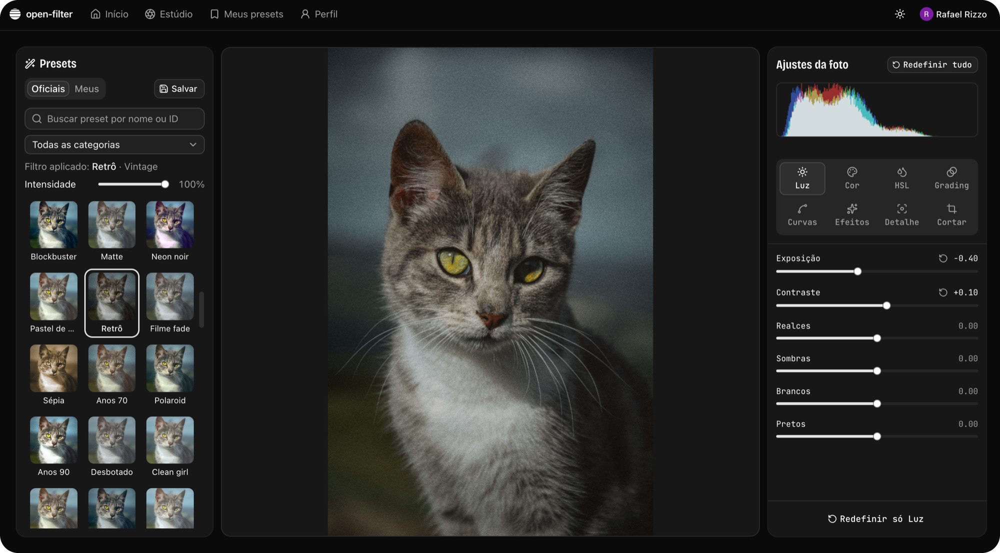

# open-filter

Site gratuito e de código aberto para aplicar filtros e ajustar uma foto direto no navegador. A foto nunca sai do seu computador: o processamento roda em WebGL e o arquivo fica no IndexedDB. Só contas e presets (um JSON pequeno) vão para o Supabase.

## O que tem

- Luz, cor, HSL por faixa, color grading, curvas, LUT 3D (.cube), efeitos e nitidez
- Cortar, girar, espelhar, endireitar e redimensionar, com grades de composição e linha do horizonte
- Presets oficiais e os seus (login com Google), com intensidade
- Antes e depois, histograma, aviso de estouro, zoom e atalhos de teclado (`?` lista), tela cheia com painel, desfazer e refazer
- Exportação em JPEG ou PNG na resolução total, e backup do álbum em ZIP

## Estrutura

- `frontend/`: Vite, React, TypeScript, TanStack Router e Query, PixiJS, Tailwind e shadcn (Base UI)
- `backend/`: migrations SQL, RLS e seeds do Supabase (sem servidor próprio). Veja `backend/README.md`

## Código aberto

O open-filter é um site para usar, não um projeto para você ter que rodar. Mesmo assim o código é aberto: se quiser entender como funciona, adaptar ou contribuir, o caminho está em [`docs/`](docs/README.md). Lá tem a arquitetura, o editor (params, shader, exportação), os dados (IndexedDB, Supabase, backup), os atalhos e o passo a passo para rodar o projeto em [`docs/desenvolvimento.md`](docs/desenvolvimento.md).

## Licença

[MIT](LICENSE).
